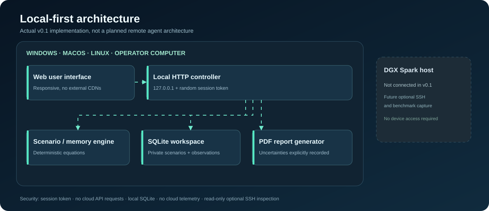

<div align="center">



# SparkTwin

**Local-first AI capacity intelligence for NVIDIA DGX Spark and private inference systems.**

Plan memory. Compare model configurations. Inspect SSH-managed Linux hosts. Calibrate performance only with real, recorded evidence.

**v0.1.0 · Development preview** &nbsp; | &nbsp; **Windows · macOS · Linux** &nbsp; | &nbsp; **Private by default**

[Get started](#get-started) · [Animated tour](#animated-product-tour) · [Architecture](#architecture) · [Features](#features) · [Download installers](#download-and-install) · [Development handover](START_HERE.md)

</div>

> [!IMPORTANT]
> **This is a working, testable development MVP, not a certified production-grade simulator.** It provides first-order analytical memory estimates, not guaranteed deployability, tokens/second or energy consumption. Remote SSH is optional, read-only and requires your existing secure OpenSSH setup. DGX Spark hardware acceptance, native installer testing and independent security review are still pending.

## Download and install

**No Python installation is needed for these prepackaged desktop apps.** Open [**GitHub Releases → SparkTwin preview installers**](https://github.com/hossain0707/SparkTwin/releases), select the newest preview and download the file matching your operating system under **Assets**.

| Platform | Recommended download | What to do next |
| --- | --- | --- |
| **Windows 10/11 (x64)** | `SparkTwin-Setup-Windows-x64.exe` | Double-click setup; launch SparkTwin from the Start Menu. |
| **Mac (Apple Silicon M1–M-series)** | `SparkTwin-macOS-Apple-Silicon-unsigned.dmg` | Open DMG → drag SparkTwin into Applications. |
| **Mac (Intel)** | `SparkTwin-macOS-Intel-unsigned.dmg` | Open DMG → drag SparkTwin into Applications. |
| **Ubuntu 24.04 (x64)** | `SparkTwin-Linux-Ubuntu-x64.deb` | Install via software installer or `sudo apt install ./<filename>.deb`. |

Windows and Linux portable ZIP/TAR.GZ packages are offered as alternatives. Every release includes **SHA-256 checksums**. **These binaries are unsigned developer previews**; operating-system security prompts may appear and clean-machine acceptance is still pending. Do not disable system security protections to install them. More details: [step-by-step installation guide](docs/INSTALL.md) and [release limitations](docs/RELEASE.md).

### After installation

Open the SparkTwin app, set your model size, quantization, context window and concurrent sessions, and compare estimated memory requirements. You can save scenarios and produce PDF evidence even **without a DGX Spark**. If you want SSH read-only inspection, bring an already-working SSH configuration and verified host key.

## The problem SparkTwin solves

A model's parameter count alone cannot answer whether it will fit on a unified-memory inference host. We must account for **weight storage, KV cache, simultaneous sequences, model geometry, OS needs, runtime allocations and safety margins**. Performance also depends on measured serving conditions. SparkTwin makes these assumptions visible and editable rather than promising imaginary benchmarks.

## Animated product tour

<p align="center"></p>

*Illustrative animation of the implemented workflow. Not a recording of a real DGX Spark or measured workload. Respects reduced-motion preferences.*

## Architecture

<p align="center"></p>

The application runs **on the operator's computer**, so a DGX Spark is **not required** to explore scenarios. The protected local web controller evaluates mathematical models, manages a local SQLite workspace and generates PDF evidence. Optional SSH inspection uses `~/.ssh/config`, already trusted `known_hosts`, a key/agent and predefined read-only commands to collect Linux memory and GPU identity. **There is no always-running agent installed on the Spark, no cloud backend and no remote model deployment.**

See [editable architecture notes](docs/ARCHITECTURE.md) and [security boundaries](docs/SECURITY.md).

## Features

| Module | What works now | Scope / limitation |
| --- | --- | --- |
| Professional responsive dashboard | Animated dark UI with custom charts and guided navigation | Not a live device telemetry dashboard |
| Device profiles | DGX Spark 128 GB and editable custom unified-memory host | Vendor GB converted to binary GiB |
| Memory engine | Model weight size, KV cache, concurrent sequences, reserves and margin | Does not simulate operator kernels, paging or fabric traffic |
| Quantization trade-offs | 2–32 bit weights; configurable KV element bytes and packing overhead | User must verify real runtime compatibility |
| Scenario planning | Live parameter editing, heuristics and four what-if variants | Comparison is analytical, not observed speed |
| Persistent scenarios | Save, reopen, delete, compare, export and restore | Local SQLite database |
| Benchmark lab | Import user-supplied JSON/CSV observations and retain provenance | No vendor benchmarks fabricated |
| Conservative calibration | Same-profile/precision nearby-scenario interpolation | At least two matching measurements; cautious confidence |
| Remote SSH inspect | Import aliases and collect Linux memory, OS and GPU identity | Requires working verified key-based SSH; never installs an agent |
| Professional reports | Download evidence-labeled PDF assessments and workspace backups | Not regulatory or official certification |
| Windows/macOS/Linux desktop | Cross-platform Python launch and optional pywebview shell | Native unsigned build workflow; platform validation pending |
| Security controls | Loopback-only bind, per-session token, Origin and Host checks, CSP | Not independently penetration-tested |

## Get started

The simplest **tested** approach is the Python application; no DGX Spark or cloud account is required. Install **Python 3.11 or newer** and run the following from the repository folder.

**Windows — PowerShell**

```powershell
py -3 -m venv .venv
.\.venv\Scripts\python.exe -m pip install -e .
.\.venv\Scripts\python.exe -m sparktwin
```

**macOS / Linux — terminal**

```bash
python3 -m venv .venv
source .venv/bin/activate
python -m pip install -e .
python -m sparktwin
```

SparkTwin opens a browser on `http://127.0.0.1:<random-port>` and stores scenarios in `~/.sparktwin/sparktwin.sqlite3`. The first Python package installation requires access to PyPI; **normal model planning does not contact an external service**.

**Optional native desktop window:**

```bash
python -m pip install -e '.[desktop]'
python desktop_launcher.py
```

## Build status and supported environments

Windows EXE installation, macOS DMGs and Ubuntu DEB packages are built in GitHub Actions and attached to versioned, **unsigned** [GitHub Releases](https://github.com/hossain0707/SparkTwin/releases) only after the entire test/build workflow succeeds. These packages are development previews, **not** signed stable releases. Detailed build and installation instructions: [docs/RELEASE.md](docs/RELEASE.md) and [docs/INSTALL.md](docs/INSTALL.md).

## Quick scenario example

Choose the illustrative generic 8B model, 4-bit weights, 32 layers, 8 KV heads, FP16 KV cache, 8192 tokens and four concurrent sequences. The application computes a first-order memory demand and budget breakdown. Those numbers are **scenario assumptions**, not a benchmark of a particular checkpoint. Change any setting and observe the impact instantly.

### Memory accounting

```text
Weights (GiB) = parameters × 1e9 × weight_bits / 8 × packing_multiplier / 2^30
KV cache (GiB) = 2 × layers × kv_heads × head_dim × kv_bytes
                 × tokens × concurrent_sequences × utilization / 2^30
Total (GiB) = weights + KV + OS + runtime + activations + safety_margin
Headroom (GiB) = decimal_hardware_GB × 1e9 / 2^30 − Total
```

NVIDIA documents DGX Spark's unified memory and 273 GB/s nominal bandwidth in its [Hardware Overview](https://docs.nvidia.com/dgx/dgx-spark/hardware.html). **Memory bandwidth does not establish application tokens/sec.** Refer to [modeling contract](docs/CALCULATIONS.md).

## Working with measured evidence

SparkTwin will *not* invent performance. Import your own CSV/JSON benchmark observations with `device`, `params_b`, `weight_bits`, `context_tokens`, `concurrency`, `output_tokens_per_second`, and `source`. It needs **at least two sufficiently close** measurements on the same device profile and precision before showing a bounded interpolated estimate. This interpolated number remains **an estimate based on user claims**, not a fresh GPU run.

Use **Benchmark lab → CSV template** to start. Imports are validated, bounded and stored only on your machine. PDF exports label assumptions, estimated values and observation provenance.

## Project status and continuation

**Local verification:** 39 Python tests passing; JavaScript syntax and packaged-source asset checks passing. Browser acceptance, actual DGX Spark SSH operation, clean-machine installer checks, and signed desktop installers remain unverified.

| Where to go | Content |
| --- | --- |
| [START_HERE.md](START_HERE.md) | Continue from a new computer, workspace or AI coding agent |
| [AGENTS.md](AGENTS.md) | Engineering constraints, code map and next actions |
| [docs/ARCHITECTURE.md](docs/ARCHITECTURE.md) | Data flow and trust boundaries |
| [docs/CALCULATIONS.md](docs/CALCULATIONS.md) | Mathematical equations and assumptions |
| [docs/VERIFICATION.md](docs/VERIFICATION.md) | Tests, known gaps and verification plan |
| [docs/PRODUCT_ROADMAP.md](docs/PRODUCT_ROADMAP.md) | Feature and production milestone roadmap |
| [docs/RELEASE.md](docs/RELEASE.md) | Cross-platform distribution and sign-off plan |
| [docs/REPOSITORY_PROFILE.md](docs/REPOSITORY_PROFILE.md) | Suggested GitHub About description and searchable topics |

## Creator and licensing

**Md Najmul Hossain** · 2026. See [LICENSE-NOTICE.md](LICENSE-NOTICE.md) for current rights. SparkTwin is an independent, unofficial project and is **not affiliated with or endorsed by NVIDIA**. NVIDIA, DGX and DGX Spark are trademarks of their respective owners.
