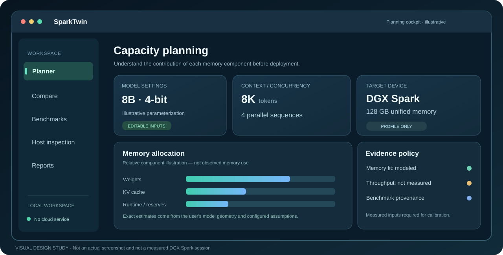

# SparkTwin

### The local-first capacity planning workbench for private AI.

Understand model memory requirements, explore deployment trade-offs, compare configurations, and document the assumptions behind your decisions — **before committing valuable GPU time**.

**NVIDIA DGX Spark · Custom Linux inference hosts · Windows / macOS / Linux**

[**Get the desktop app**](https://github.com/hossain0707/SparkTwin/releases/tag/v0.1.0-preview.7) · [See the product tour](#product-tour) · [Explore the architecture](#architecture) · [Read the documentation](#documentation-and-project-continuity)

> [!IMPORTANT]
> **Development preview — not production-validated.** SparkTwin is a working analytical planner, not an NVIDIA-certified product, deployment guarantee, or performance simulator validated on a representative hardware fleet. Its memory calculations are **estimates**, not measured consumption. Model throughput appears only when user-provided benchmark evidence supports a conservative interpolation. Released installers are **unsigned previews**; clean-machine acceptance, DGX Spark field testing, and independent security review remain open.

---

## Why SparkTwin exists

Deploying an LLM on a unified-memory machine involves more than counting parameters. **Weights, quantization overhead, attention geometry, context length, concurrent sequences, KV cache, runtime allocations, operating-system reservations and headroom** all contribute to whether a configuration is plausible.

SparkTwin makes that budget explicit and editable. It is designed for AI engineers, research labs, enterprise private-AI teams, and anyone comparing inference configurations before deployment.

<table>
<tr>
<td width="33%" valign="top"><strong>PLAN</strong> Transparent, device-aware first-order memory estimates.</td>
<td width="33%" valign="top"><strong>COMPARE</strong> Explore context, precision, model geometry, and concurrency trade-offs.</td>
<td width="34%" valign="top"><strong>PROVE</strong> Preserve observations and export evidence-labeled PDF reports.</td>
</tr>
</table>

## Download and install

**The easiest way to start:** Download the installer for your operating system, launch SparkTwin, and begin planning immediately. **Python is not required for the prepackaged desktop versions.** A DGX Spark is optional for offline model planning.

**[Open the verified preview release →](https://github.com/hossain0707/SparkTwin/releases/tag/v0.1.0-preview.7)**

| Your computer | Installer | Installation |
| :--- | :--- | :--- |
| **Windows 10/11 — x64** | [Download Setup EXE](https://github.com/hossain0707/SparkTwin/releases/download/v0.1.0-preview.7/SparkTwin-Setup-Windows-x64.exe) | Run the setup wizard; launch from Start Menu |
| **macOS — Apple Silicon** | [Download Apple Silicon DMG](https://github.com/hossain0707/SparkTwin/releases/download/v0.1.0-preview.7/SparkTwin-macOS-Apple-Silicon-unsigned.dmg) | Open the DMG; drag app into Applications |
| **macOS — Intel** | [Download Intel DMG](https://github.com/hossain0707/SparkTwin/releases/download/v0.1.0-preview.7/SparkTwin-macOS-Intel-unsigned.dmg) | Open the DMG; drag app into Applications |
| **Ubuntu Linux 24.04 — x64** | [Download DEB](https://github.com/hossain0707/SparkTwin/releases/download/v0.1.0-preview.7/SparkTwin-Linux-Ubuntu-x64.deb) | Install with your package manager |
| **Windows — portable** | [Download ZIP](https://github.com/hossain0707/SparkTwin/releases/download/v0.1.0-preview.7/SparkTwin-Portable-Windows-x64.zip) | Extract the complete folder; launch SparkTwin |
| **Linux — portable** | [Download TAR.GZ](https://github.com/hossain0707/SparkTwin/releases/download/v0.1.0-preview.7/SparkTwin-Portable-Linux-x64.tar.gz) | Extract and run with required GTK/WebKitGTK libraries |

**Verify your download:** [SHA-256 checksums](https://github.com/hossain0707/SparkTwin/releases/download/v0.1.0-preview.7/SHA256SUMS.txt) · [Step-by-step installation](docs/INSTALL.md) · [Release details](docs/RELEASE.md)

> [!CAUTION]
> The macOS packages are not notarized and the Windows installer is not code-signed. Platform security warnings may appear. Do not weaken device security policies just to bypass a warning. The preview release is intended for evaluation; production-wide deployment is not yet recommended.

---

## Product tour

  

SparkTwin guides you through five connected stages:

1. **Configure:** choose DGX Spark or a custom host and describe the model, quantization, context window, and concurrency.
2. **Estimate:** inspect weights, KV-cache allocation, runtime/OS reserves, a configured safety margin, and remaining headroom.
3. **Compare:** save scenarios and examine how configuration changes affect the analytical memory budget.
4. **Calibrate:** import **real, attributable** benchmark observations when available; refuse unsupported performance predictions.
5. **Report:** create PDF evidence with inputs, scope, limitations, and recorded provenance.

*The animated illustration shows the product flow, not a real DGX Spark benchmark or captured application session. Animation includes reduced-motion fallback.*

### Planning cockpit

  

Illustrative interface design study. It is **not a screenshot** or real hardware telemetry. The application determines actual numerical estimates from the user's configured inputs.

---

## Capabilities

| Area | Included in the current development preview | Boundary |
| :--- | :--- | :--- |
| **Unified-memory planning** | Device profiles, editable memory budget, reserves and headroom | Analytical model; not a physical GPU memory allocator |
| **Model geometry** | Parameters, precision, transformer layer/head geometry, KV-cache settings | Requires correct architecture assumptions |
| **Scenario comparison** | Editable what-if variants, persistent scenarios, save/reopen/delete, workspace export | Comparative memory estimate, not measured tokens/sec |
| **Benchmark lab** | Validated user CSV/JSON imports, provenance fields, conservative interpolation | No synthetic observations presented as measured evidence |
| **Remote inspection** | Optional OpenSSH host aliases, read-only Linux memory and GPU identity | Requires verified host key and working key-based SSH |
| **Reports** | Evidence-labeled PDFs, assumptions and scope, local SQLite history | Not a regulatory or third-party certification |
| **Desktop access** | Native preview builds for Windows, Intel/Apple Silicon macOS, Ubuntu x64 | Builds verified in CI; unsigned and not field-accepted |
| **Local security** | Loopback binding, session-token checks, Origin/Host validation, CSP | Security review is not a completed penetration test |

### What SparkTwin deliberately does *not* claim

- **No guaranteed model fit.** True deployment depends on framework implementation, kernel allocations, memory fragmentation and runtime behavior.
- **No unmeasured throughput.** GPU memory or advertised bandwidth alone cannot reliably determine tokens per second.
- **No mandatory cloud account.** Planning works locally; data is stored on the operator's machine.
- **No automatic GPU deployment.** Optional SSH inspection is read-only and does not install a remote service.
- **No NVIDIA affiliation.** SparkTwin is independent tooling designed to complement, not replace, vendor management products.

## Architecture

  

**The application runs locally.** A responsive browser UI or optional packaged desktop window communicates with a loopback-bound Python controller. The capacity engine performs deterministic calculations, SQLite stores scenarios and uploaded benchmark observations, and the PDF component prepares the evidence report. An already configured OpenSSH client may optionally inspect a reachable Linux host. **There is no required remote agent or hosted backend.**

<strong>View the editable system diagram</strong>

~~~mermaid
flowchart LR
    U[Windows / macOS / Linux user] --> UI[Local web UI or desktop shell]
    UI --> API[Loopback API and session controls]
    API --> M[Deterministic memory engine]
    API --> B[Benchmark calibration]
    API --> DB[(Local SQLite)]
    API --> R[PDF evidence reports]
    API -. Verified OpenSSH; read only .-> H[DGX Spark or Linux host]
    B --> DB
    M --> R
    DB --> R
~~~

More detail: [Architecture and data flow](docs/ARCHITECTURE.md) · [Security model](docs/SECURITY.md) · [Visual design system](docs/DESIGN_SYSTEM.md)

---

## Calculation methodology

SparkTwin uses an explicit **first-order memory accounting model**. It never assumes a particular model checkpoint or serving backend is perfectly described by parameter count alone.

| Component | Principle |
| :--- | :--- |
| **Weights** | Parameter count × bits per weight × configurable packing overhead |
| **KV cache** | 2 × layers × KV heads × head dimension × element bytes × retained tokens × concurrent sequences |
| **Additional allocations** | Runtime, activations, operating system, and safety reserve |
| **Headroom** | Available device memory − modeled total allocation |

For a nominal **128 GB** unified-memory profile, the application converts vendor decimal GB into binary GiB rather than treating the two units as equal. Context length, grouped-query attention configuration, precision, and simultaneous requests can materially change the answer.

**Calibration is evidence-gated:** output-token throughput interpolation requires at least two sufficiently nearby, matching benchmark observations; unsupported or distant scenarios should not receive an invented performance number. The detailed formulas and constraints are documented in [CALCULATIONS.md](docs/CALCULATIONS.md).

## Quick start from source

Use the desktop installers above for ordinary evaluation. Developers can instead run the Python version on Windows, macOS, or Linux using **Python 3.11+**.

<strong>Windows — PowerShell</strong>

~~~powershell
git clone https://github.com/hossain0707/SparkTwin.git
cd SparkTwin
py -3 -m venv .venv
.\.venv\Scripts\python.exe -m pip install -e .
.\.venv\Scripts\python.exe -m sparktwin
~~~

<strong>macOS / Linux</strong>

~~~bash
git clone https://github.com/hossain0707/SparkTwin.git
cd SparkTwin
python3 -m venv .venv
source .venv/bin/activate
python -m pip install -e .
python -m sparktwin
~~~

A free local port on `127.0.0.1` is used; the private workspace resides under `~/.sparktwin/`. Installing Python dependencies initially requires network access to the package index, but normal scenario modeling requires no cloud connection.

Optional native window: install `python -m pip install -e '.[desktop]'`, then run `python desktop_launcher.py`.

### Development and testing

~~~bash
python -m pip install -e '.[dev]'
python -m pytest -q
node --check sparktwin/web/app.js
python desktop_launcher.py --self-test
~~~

GitHub Actions runs a cross-platform test/build matrix and publishes **versioned unsigned developer previews** only after the relevant workflow passes. See the [CI workflow](.github/workflows/ci.yml), [release checklist](docs/RELEASE.md), and [verification ledger](docs/VERIFICATION.md).

---

## Project maturity

| Verification area | Current status |
| :--- | :--- |
| Local application and modeling features | **Implemented in development MVP** |
| Local Python automated tests | **39 passed** in recorded local validation |
| Windows, macOS and Linux build matrix | **CI build verified** for the tagged preview |
| Tagged downloadable preview installers | **Published and verified** as release assets |
| Clean-machine installer acceptance | **Pending** |
| Physical DGX Spark inspection and performance validation | **Pending** |
| Independent security review, code signing, macOS notarization | **Pending** |

Do not treat the CI badge or release assets as proof of production acceptance. [Detailed validation evidence](docs/VERIFICATION.md) and [the roadmap](docs/PRODUCT_ROADMAP.md) document what remains.

## Documentation and project continuity

| Read this | To understand |
| :--- | :--- |
| **[START_HERE.md](START_HERE.md)** | Resume development from another computer, agent, or workspace |
| [AGENTS.md](AGENTS.md) | Engineering constraints, repository map and decision-making rules |
| [ARCHITECTURE.md](docs/ARCHITECTURE.md) | Components, architecture, trust boundaries and data flows |
| [CALCULATIONS.md](docs/CALCULATIONS.md) | Equations, hardware assumptions and model limitations |
| [SECURITY.md](docs/SECURITY.md) | Local and optional SSH security model |
| [VERIFICATION.md](docs/VERIFICATION.md) | Evidence, test coverage and production-release gates |
| [PRODUCT_ROADMAP.md](docs/PRODUCT_ROADMAP.md) | Planned engineering milestones |
| [RELEASE.md](docs/RELEASE.md) | Packaging and acceptance requirements |
| [INSTALL.md](docs/INSTALL.md) | OS-specific download and installation guide |
| [DESIGN_SYSTEM.md](docs/DESIGN_SYSTEM.md) | Visual design, animation and accessibility guidance |

## Creator, rights and disclosure

**Created and maintained by Md Najmul Hossain** · © 2026.

See [LICENSE-NOTICE.md](LICENSE-NOTICE.md) for current distribution and reuse terms. A public repository does **not** automatically grant an open-source software license.

SparkTwin is independent of and not sponsored, affiliated with, or endorsed by NVIDIA Corporation. NVIDIA, DGX, DGX Spark and other trademarks belong to their respective owners.

**Plan with clarity. Compare with context. Validate with evidence.**

[Download a preview](https://github.com/hossain0707/SparkTwin/releases/tag/v0.1.0-preview.7) · [Open the development handover](START_HERE.md) · [View known limitations](docs/VERIFICATION.md)

