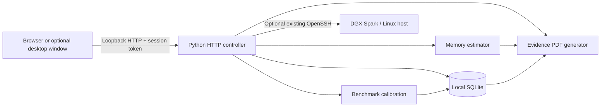

# SparkTwin architecture (implemented, v0.1.0)

## Logical deployment

The controller is **always bound to `127.0.0.1`** on the user's own desktop, never on a public network interface. Desktop computers can be Windows, macOS or Linux. There is no SparkTwin service or code executed as a resident process on the remote NVIDIA machine.

## API

- `GET /` serves the local interface, embedding an unpredictable per-process token.
- `GET /app.js`, `/styles.css`, `/mark.svg` serve packaged local assets.
- `GET /api/health` gives minimal health/version info.
- `GET /api/bootstrap` provides default scenario, profile constants and saved data.
- `POST /api/assess` returns memory budget, what-if variants and evidence calibration.
- `POST /api/report` exports a PDF marked **engineering estimate**.
- `GET/POST /api/scenarios`, `DELETE /api/scenarios/{id}` store scenarios.
- `GET /api/benchmarks`, `POST /api/benchmarks/import`, `DELETE /api/benchmarks/{id}` store user observations.
- `GET /api/export`, `POST /api/restore` transfer bounded JSON backup files.
- `GET /api/ssh/aliases` lists normal SSH aliases without reading credentials.
- `POST /api/ssh/inspect` invokes strict system OpenSSH for predefined remote read-only diagnostics.

All protected API calls require `X-SparkTwin-Token` and same-origin Host checks. No cloud endpoints, plugins or software telemetry are used. The browser must originate from the local app page; static source is never sent to an external cloud.

## Evidence and data

Scenarios include all modeling assumptions; benchmark records include claimed source, device profile, parameters, precision, context, concurrency and measured output tokens/s. Save data to `~/.sparktwin/sparktwin.sqlite3` (override `SPARKTWIN_HOME`). Files are best-effort private under Unix; OS-level account security still matters. JSON exports are plaintext and may contain sensitive user-written notes or benchmark provenance: handle accordingly.

## Security trust boundaries

- **Browser → local API:** session token, Content-Security-Policy, response controls, Host and Origin checks. No authentication across multiple OS users is provided.
- **Local app → SSH:** existing OpenSSH configuration, public host fingerprint pinned in `known_hosts`, key-based authentication and bounded diagnostics. No password prompts, no host-key auto-acceptance, no user-provided commands.
- **Local data:** SQLite with parameterized queries; bounded import size; not encrypted at rest.
- **Analytics:** no runtime simulation, no hidden calibration data, no guaranteed performance.

## Distinct from SparkCert

SparkCert validates already running AI applications; SparkTwin plans memory/capacity before deploying a workload. They are independent software projects. No shared dependencies or credentials are assumed.
